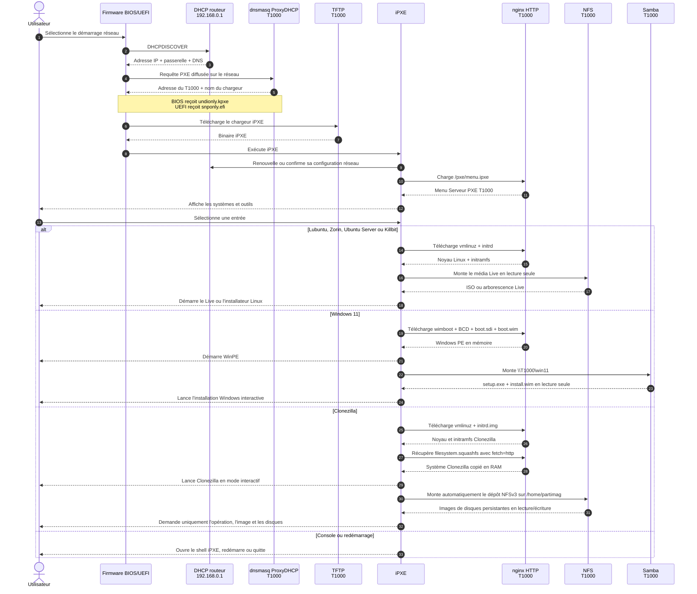

# Architecture et cinématique PXE du T1000

Ce document représente l'installation validée à domicile sur `192.168.0.102/24`. Lors du déploiement à l'ANS, les adresses changeront, mais les rôles et les flux resteront identiques.

## 1. Architecture générale

```mermaid
flowchart TB
    CLIENT[Poste client<br/>BIOS ou UEFI<br/>Carte réseau PXE]
    LAN[Réseau local Ethernet<br/>192.168.0.0/24]
    ROUTER[Routeur existant<br/>DHCP + passerelle + DNS<br/>192.168.0.1]

    subgraph T1000[Serveur PXE T1000 — 192.168.0.102]
        DNSMASQ[dnsmasq<br/>ProxyDHCP + TFTP]
        TFTP[TFTP — UDP 69<br/>undionly.kpxe BIOS<br/>snponly.efi UEFI<br/>start.ipxe]
        NGINX[nginx — TCP 80<br/>menu iPXE<br/>noyaux + initrd<br/>WinPE + Clonezilla]
        NFS[NFS — TCP 2049<br/>Live Linux en lecture seule<br/>images Clonezilla en lecture/écriture]
        SMB[Samba — TCP 445<br/>fichiers Windows 11<br/>lecture seule]

        subgraph NVME[NVMe — système]
            UBUNTU[Ubuntu Server 26.04]
            TFTPFILES[/srv/tftp]
            WEBFILES[/var/www/html/pxe]
            CONFIGS[/etc<br/>dnsmasq + nginx + NFS + Samba + Netplan]
        end

        subgraph SSD[SSD 1 To — /srv/pxe-data]
            ISOS[ISO Linux]
            LIVES[Arborescences Live et Killbit]
            WIN11[Windows 11 25H2<br/>install.wim + setup.exe]
            CLONEZILLA[Clonezilla 3.3.3-37<br/>filesystem.squashfs]
            CLONEIMAGES[Images Clonezilla<br/>sauvegardes persistantes]
        end
    end

    CLIENT <--> LAN
    ROUTER <--> LAN
    LAN <--> DNSMASQ
    LAN <--> TFTP
    LAN <--> NGINX
    LAN <--> NFS
    LAN <--> SMB

    DNSMASQ --> TFTPFILES
    TFTP --> TFTPFILES
    NGINX --> WEBFILES
    NGINX --> ISOS
    NGINX --> WIN11
    NGINX --> CLONEZILLA
    NFS --> ISOS
    NFS --> LIVES
    NFS --> CLONEIMAGES
    SMB --> WIN11
    UBUNTU --> DNSMASQ
    UBUNTU --> NGINX
    UBUNTU --> NFS
    UBUNTU --> SMB
    CONFIGS --> UBUNTU
```

### Répartition des responsabilités

| Composant | Fonction | Ne fait pas |
|---|---|---|
| Routeur `192.168.0.1` | Attribue l'adresse IP, la route et le DNS | Ne fournit pas le programme de démarrage PXE |
| dnsmasq sur T1000 | Répond comme ProxyDHCP et indique le chargeur à utiliser | N'attribue pas une seconde adresse IP et ne remplace pas le DHCP existant |
| TFTP | Livre le premier petit chargeur iPXE | Ne transporte pas les gros médias |
| nginx/HTTP | Livre le menu, les noyaux, initrd, WinPE et le squashfs Clonezilla | Ne fournit pas les racines Live Linux montées |
| NFS | Expose les médias Live Linux en lecture seule et le dépôt d'images Clonezilla en lecture/écriture | N'est pas utilisé pour Windows 11 |
| Samba | Expose en lecture seule les fichiers d'installation Windows | N'est pas utilisé par les Live Linux ou Clonezilla |
| SSD 1 To | Stocke les ISO, Live, Windows et Clonezilla | Ne contient pas le système Ubuntu du serveur |
| NVMe | Héberge Ubuntu, les services, les scripts et les petits fichiers de démarrage | Ne stocke pas les gros médias d'installation |

## 2. Cinématique de démarrage d'un PC



## 3. Déroulé étape par étape

1. Le firmware du poste initialise la carte réseau et diffuse une demande DHCP/PXE.
2. Le routeur attribue l'adresse IP du poste. T1000 ne remplace pas ce DHCP.
3. dnsmasq répond uniquement à la partie PXE et indique le chargeur adapté au firmware.
4. Le poste télécharge par TFTP `undionly.kpxe` en BIOS ou `snponly.efi` en UEFI.
5. iPXE démarre et charge le menu par HTTP depuis T1000.
6. L'utilisateur choisit manuellement un système ou un outil.
7. iPXE charge le noyau et l'environnement initial correspondant.
8. Le système poursuit avec le stockage adapté : NFS pour les Live Linux, Samba pour Windows, HTTP pour le système Clonezilla puis montage automatique NFSv3 pour ses images persistantes.
9. L'installateur ou l'outil devient interactif sur le poste client.
10. Les écritures sur les disques du client ne commencent qu'après les confirmations propres à l'installateur ou à l'outil sélectionné.

## 4. Ports sollicités

| Flux | Port | Sens principal | Usage |
|---|---:|---|---|
| DHCP | UDP 67/68 | Client ↔ routeur | Adresse IP du client |
| ProxyDHCP | UDP 67 et 4011 | Client ↔ T1000 | Informations de démarrage PXE |
| TFTP | UDP 69 | Client ← T1000 | Premier chargeur iPXE |
| HTTP | TCP 80 | Client ← T1000 | Menu, noyaux, initrd, WinPE, Clonezilla |
| RPC/NFS | TCP/UDP 111 et TCP 2049 | Client ↔ T1000 | Live Linux en lecture seule et images Clonezilla en lecture/écriture |
| SMB | TCP 445 | WinPE ↔ T1000 | Fichiers d'installation Windows 11 |

## 5. Points de vigilance

- Un seul ProxyDHCP doit être actif sur le réseau : ne pas rallumer T800 tant que dnsmasq fonctionne sur T1000.
- Le réadressage doit mettre à jour Netplan, dnsmasq, les menus, NFS, Samba, `install.bat`, `boot.ipxe` et les chargeurs iPXE embarqués.
- Windows et Clonezilla peuvent modifier les disques du poste client après confirmation de l'utilisateur ; le PXE ne sélectionne aucun disque automatiquement.
- Un contrôle HTTP ou un service actif ne remplace jamais un véritable test de démarrage BIOS/UEFI.
