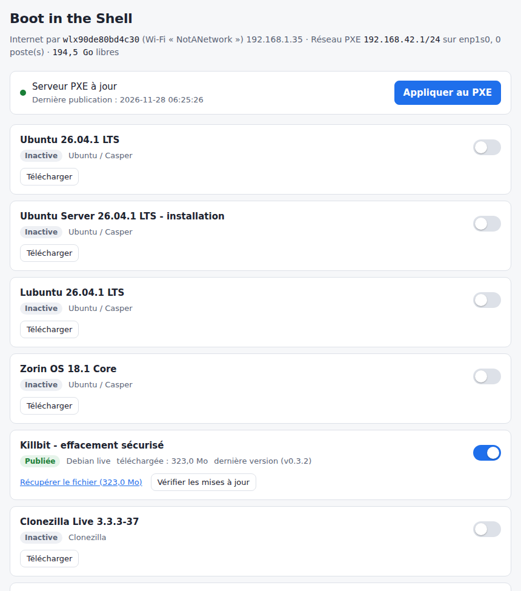
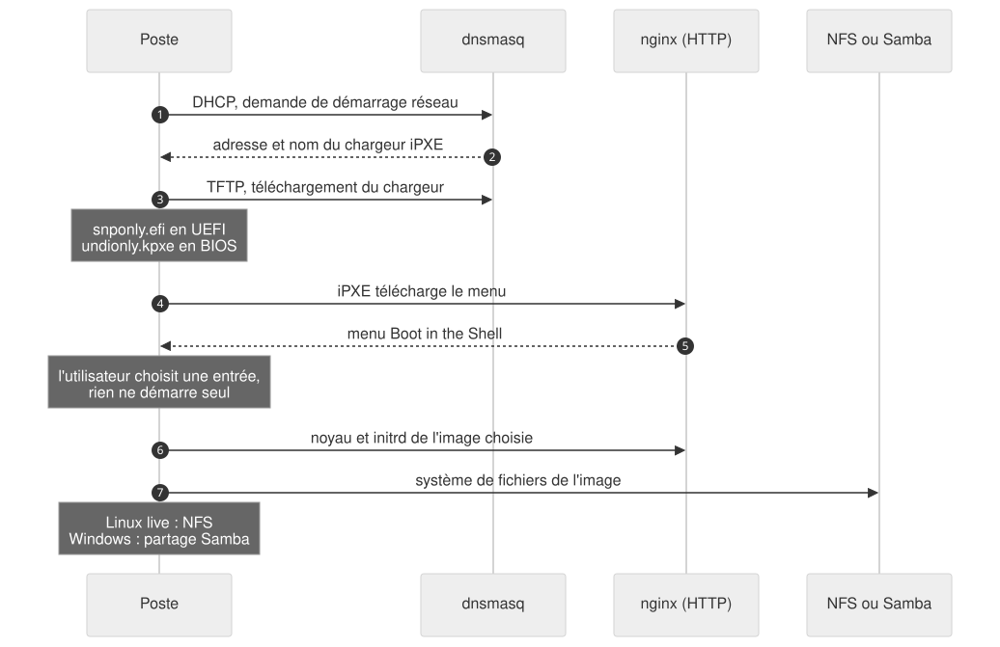
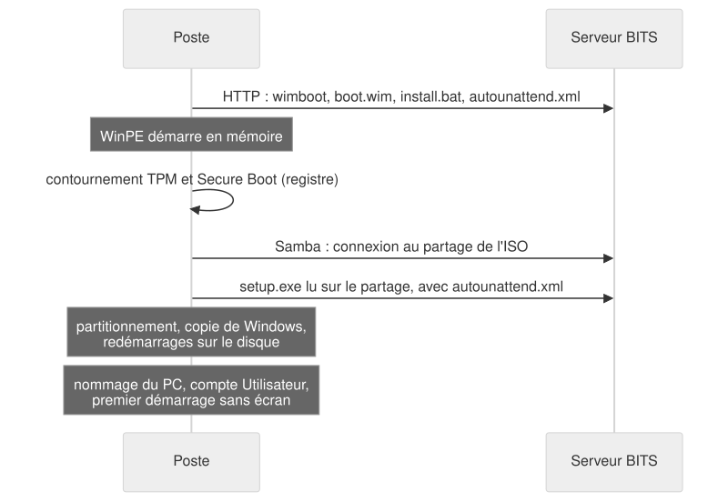

# Boot in the Shell

[](https://github.com/Action-Numerique-Solidaire/boot-in-the-shell/actions/workflows/verif-scripts.yml)
[](https://github.com/Action-Numerique-Solidaire/boot-in-the-shell/actions/workflows/paquet.yml)
[](https://github.com/Action-Numerique-Solidaire/boot-in-the-shell/actions/workflows/amorcage.yml)
[](LICENSE)

Serveur de démarrage réseau (PXE) pour les ateliers de reconditionnement
d'[Action Numérique Solidaire](https://github.com/Action-Numerique-Solidaire).
Un PC branché sur le réseau de l'atelier démarre sans clé USB sur l'outil
choisi dans un menu : effacement sécurisé des disques, installation d'Ubuntu,
de Zorin OS ou de Windows 11, clonage avec Clonezilla.

Le serveur est un Debian 13 qui s'installe depuis une clé USB, se met à jour
seul et se pilote depuis une page web.

<p align="center">
  
</p>

**Installer un serveur : [GUIDE-INSTALLATION.md](GUIDE-INSTALLATION.md)**, de la
préparation de la clé USB au premier poste démarré sur le réseau.

---

## Sommaire

- [Le montage dans l'atelier](#le-montage-dans-latelier)
- [Ce qui se passe quand un poste démarre](#ce-qui-se-passe-quand-un-poste-démarre)
- [Les images proposées](#les-images-proposées)
- [Ajouter une image au menu](#ajouter-une-image-au-menu)
- [Windows 11](#windows-11)
- [Composition du serveur](#composition-du-serveur)
- [Installer](#installer)
- [Sécurité](#sécurité)
- [Contenu du dépôt](#contenu-du-dépôt)
- [Tests](#tests)

---

## Le montage dans l'atelier

Le mode réseau est choisi à l'installation du serveur, selon la carte réseau
utilisée pour l'installer.

### Passerelle : installation en Wi-Fi

Le serveur reçoit internet par le Wi-Fi et sert un réseau à lui, sur sa carte
Ethernet reliée à un switch. Les postes de l'atelier ne touchent pas au réseau
de la box.

<p align="center"></p>

Sur le réseau 192.168.42.0/24, le serveur assure :

| Service | Détail |
|---|---|
| DHCP | adresses de 192.168.42.100 à 192.168.42.250 |
| DNS | relais vers les serveurs DNS de la box |
| Routage | les postes accèdent à internet (NAT) ; ils ne sont pas joignables depuis le réseau de la box |
| Garde DHCP | si un autre serveur DHCP répond sur la carte Ethernet (câble branché sur la box par erreur), le serveur refuse de distribuer des adresses et l'affiche dans l'interface web |

L'interface web et SSH répondent sur les deux réseaux : depuis le Wi-Fi à
l'adresse donnée par la box, depuis le switch à `192.168.42.1`.

### Proxy : installation par câble

Le serveur rejoint le réseau existant. La box continue de distribuer les
adresses ; le serveur répond seulement aux demandes de démarrage réseau
(ProxyDHCP).

<p align="center"></p>

---

## Ce qui se passe quand un poste démarre

Le poste démarre sur le réseau depuis son firmware (touche F12 ou équivalent,
entrée « PXE », « Network » ou « IPv4 »). Les postes UEFI et BIOS sont pris en
charge.

<p align="center"></p>

Le menu affiché sur le poste :

```text
Boot in the Shell - 192.168.42.1
---------------- Systèmes et outils ----------------
Killbit - effacement sécurisé
Windows 11 - installation (guidée)
Windows 11 - installation automatique - EFFACE LE DISQUE
----------------------------------------------------
Démarrer sur le disque local
Console iPXE
Redémarrer
```

Il ne contient que les images publiées depuis l'interface web, et n'a pas de
choix par défaut.

---

## Les images proposées

| Image | Usage | Démarrage | Vérification |
|---|---|---|---|
| Killbit | effacement sécurisé des disques ([killbit-image](https://github.com/Action-Numerique-Solidaire/killbit-image)) | Debian live, racine en NFS | fichier d'empreinte publié avec chaque version |
| Ubuntu 26.04.1 LTS | système live et installation | Casper, racine en NFS | `SHA256SUMS` d'Ubuntu |
| Ubuntu Server 26.04.1 LTS | installation | Casper, racine en NFS | `SHA256SUMS` d'Ubuntu |
| Lubuntu 26.04.1 LTS | système live et installation, pour les PC modestes | Casper, racine en NFS | `SHA256SUMS` d'Ubuntu |
| Zorin OS 18.1 Core | système live et installation | Casper, racine en NFS | empreinte inscrite au catalogue |
| Clonezilla Live 3.3.3-37 | clonage et restauration ; les images de disque sont rangées sur le serveur | Debian live, squashfs en HTTP | empreinte inscrite au catalogue |
| Windows 11 | installation guidée ou automatique | WinPE par wimboot, sources en Samba | empreinte publiée par Microsoft |

Le catalogue est
[`03 - prototype-generic/config/media.conf.example`](03%20-%20prototype-generic/config/media.conf.example).
Chaque image est vérifiée par son empreinte SHA-256 avant d'être servie. Pour
Killbit, le serveur suit la dernière version publiée et signale dans
l'interface web qu'une nouvelle version est disponible.

---

## Ajouter une image au menu

<p align="center"></p>

- **Télécharger** prépare une image sans la mettre au menu : utile pour les
  images de plusieurs gigaoctets.
- Désactiver une image la retire du menu ; le fichier téléchargé est gardé.
- La publication recharge la configuration des services sans couper les postes
  en cours d'installation.
- La même publication est relancée à chaque démarrage du serveur
  (`bits-sync.service`) et après chaque mise à jour du paquet.
- Le journal de l'opération s'affiche en direct dans l'interface web, et avec
  `bitsctl log -f`.

---

## Windows 11

Microsoft ne publie pas d'adresse fixe pour l'ISO de Windows 11 et refuse de
fournir un lien de téléchargement à un programme. Le lien est obtenu dans un
navigateur, sur la page de Microsoft, et collé dans la carte Windows de
l'interface web, qui affiche les étapes. Il est valable 24 heures. Le serveur
vérifie l'ISO avec l'empreinte publiée sur la même page.

Le menu propose deux entrées :

| Entrée | Déroulement |
|---|---|
| **installation (guidée)** | le programme d'installation de Windows pose ses questions habituelles |
| **installation automatique - EFFACE LE DISQUE** | aucune question, jusqu'au bureau |

L'installation automatique :

- efface le disque 0 sans confirmation et le partitionne en GPT (UEFI) ou en
  MBR (BIOS), selon le mode de démarrage du poste ;
- installe Windows 11 Famille en français, clavier AZERTY, fuseau horaire de
  Paris ;
- désactive les contrôles TPM 2.0, Secure Boot, processeur, mémoire et
  stockage ;
- crée un compte local « Utilisateur », administrateur, sans mot de passe ;
- n'affiche aucun écran au premier démarrage : pas de compte Microsoft, pas
  de réseau demandé, confidentialité au réglage le plus restrictif ;
- nomme le PC `ANS-<numéro de série>` (15 caractères au plus) ; si le numéro
  de série est vide ou générique, Windows garde un nom aléatoire.

Windows s'active seul si le PC porte une licence d'origine.

<p align="center"></p>

Le partage Samba est en lecture seule, réservé au réseau des postes, avec un
compte dédié : Windows 11 refuse les partages ouverts en invité.

---

## Composition du serveur

<p align="center"></p>

| Élément | Rôle |
|---|---|
| `bits-pxe-server` (paquet) | `bitsctl`, scripts de publication, unités systemd ; dépend de dnsmasq, nginx, NFS, iPXE, nftables |
| `bits-web` (paquet) | interface web : un service Python sans dépendance, derrière nginx ; il ne peut lancer que quatre commandes `bitsctl` (activer, désactiver, télécharger, publier) |
| `bitsctl` | pilotage en ligne de commande : `status`, `apply`, `media list`, `media enable <id>`, `media download <id>`, `log -f` |
| Étapes de publication | `00` contrôle de la configuration, `10` prérequis, `20` disque de données, `30` réseau, `40` téléchargement, `50` chargeurs iPXE, `60` menu et partages, `70` activation et contrôle des services |
| Mises à jour | unattended-upgrades installe chaque jour les correctifs de Debian et les nouvelles versions de BITS |

---

## Installer

### Un PC dédié, depuis une clé USB

Graver `bits-amorcage.iso` (release, environ 170 Mo), démarrer le PC dessus et
choisir *Installer le serveur BITS*. **Le disque interne est entièrement
effacé.** Seules les questions du réseau sont posées : la carte, et en Wi-Fi
le réseau et son mot de passe. Au redémarrage, la console affiche l'adresse de
l'interface web.

<p align="center"></p>

Pas à pas : [GUIDE-INSTALLATION.md](GUIDE-INSTALLATION.md). Construction de la
clé : [05 - bootstrap-iso](05%20-%20bootstrap-iso/README.md).

### Une machine Debian ou Ubuntu existante

```bash
echo "deb [trusted=yes] https://github.com/Action-Numerique-Solidaire/boot-in-the-shell/releases/download/apt-test/ ./" \
  | sudo tee /etc/apt/sources.list.d/bits.list
sudo apt update && sudo apt install bits-pxe-server bits-web
```

Puis choisir les images dans l'interface web (`http://<adresse>/`), ou :

```bash
sudo bitsctl media enable killbit
sudo bitsctl apply
```

Le paquet s'installe en mode proxy et ne modifie pas la configuration réseau
de la machine. Le mode passerelle se règle dans
`/etc/bits-pxe-server/pxe.env` : voir le
[PLAYBOOK](03%20-%20prototype-generic/PLAYBOOK.md#mode-passerelle--réseau-pxe-dédié).

> **Phase alpha.** Le canal stable (`download/apt/`) n'existera qu'avec le
> premier tag `v*`. D'ici là, les paquets viennent du canal d'essai,
> `download/apt-test/`.

---

## Sécurité

Le serveur est conçu pour le réseau d'un atelier, pas pour un réseau partagé :

- l'interface web n'a pas d'authentification ;
- après une installation par la clé, root se connecte en SSH avec le mot de
  passe `admin` : le changer avec `passwd` au premier démarrage ;
- en mode passerelle, les postes ne sont pas joignables depuis le réseau de la
  box ; le serveur, lui, l'est.

---

## Contenu du dépôt

| Dossier | Contenu |
|---|---|
| [`03 - prototype-generic/`](03%20-%20prototype-generic/README.md) | le serveur PXE : scripts de publication, catalogue, [PLAYBOOK](03%20-%20prototype-generic/PLAYBOOK.md) d'exploitation |
| [`packaging/`](packaging/) | construction des paquets `bits-pxe-server` et `bits-web`, et du dépôt apt |
| [`05 - bootstrap-iso/`](05%20-%20bootstrap-iso/README.md) | la clé USB d'installation : `mini.iso` de Debian 13, preseed, firmwares réseau |
| [`tests/`](tests/README.md) | tests des paquets, du dépôt, de l'ISO et de la chaîne PXE complète en machines virtuelles |
| [`tools/`](tools/README.md) | gravure de la clé avec garde-fous ; compilation d'iPXE |
| `.github/workflows/` | CI et publication des releases |
| `02 - prototype-t1000/`, [`04 - live-iso/`](04%20-%20live-iso/README.md) | prototypes précédents, **obsolètes** |

---

## Tests

Les mêmes commandes tournent chez un contributeur et en CI :

```bash
tests/run-all.sh                  # paquets, dépôt apt, démarrage de l'ISO (~1 min 30)
sudo tests/run-all.sh             # + chaîne PXE complète en VM (~3 min)
sudo tests/run-all.sh --complet   # + installation complète depuis l'ISO (~20 min)
```

Les tests en machines virtuelles démarrent de vrais postes UEFI et BIOS sur le
serveur, dans les deux modes réseau. Le Wi-Fi de l'installateur et
l'installation de Windows ne s'éprouvent que sur du matériel réel. Détail :
[tests/README.md](tests/README.md).

---

## Licence

[GNU GPL v3](LICENSE).

Les schémas sont dessinés depuis leurs sources Mermaid,
[`docs/schemas/*.mmd`](docs/schemas/), par `tools/generer-schemas.sh`. Projet porté par
[Action Numérique Solidaire](https://github.com/Action-Numerique-Solidaire).
